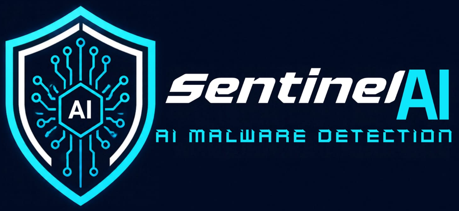

# SentinelAI



[Project website](https://sentinelai-site.vercel.app/) ·
[GitHub releases](https://github.com/sudip-2k6/SentinelAI/releases) ·
[Docker setup](docs/DOCKER.md) · [Contributing](CONTRIBUTING.md)

SentinelAI is an offline desktop application for inspecting Windows PE and Linux ELF files.
It shows SHA-256 fingerprints, executable metadata, imports, section entropy, and string marker
counts. Each executable format can use an independently trained and approved local classifier.
A fresh installation runs in static-analysis mode. Optional model bundles enable scoring
for supported formats. [Model installation](docs/DATASETS.md#install-the-release-models)

[Download the approved PE and ELF models](https://github.com/sudip-2k6/SentinelAI/releases/download/v0.1.9/SentinelAI-0.1.2-models.zip)

SentinelAI's source is available under the [MIT License](LICENSE).
Clone the repository before choosing your setup.

```sh
git clone https://github.com/sudip-2k6/SentinelAI.git
cd SentinelAI
```

## Run locally with Docker

With Docker Compose in Linux container mode, run
`docker compose up --build --detach --wait`, then
`docker compose exec -T sentinelai cat /tmp/sentinel-desktop/password`.
Open [the local desktop](http://127.0.0.1:6080/vnc.html?resize=scale) and enter
the generated password. See [the Docker guide](docs/DOCKER.md) for file access,
persistent storage, and troubleshooting.

## Start on Windows 10 or 11

**[Download SentinelAI Setup for Windows x64](https://github.com/sudip-2k6/SentinelAI/releases/latest/download/SentinelAI-Setup-x64.exe)**

Run the installer and launch **SentinelAI** from the Start menu. Setup installs
for your Windows account. Setup shows download progress and lets you cancel
while it downloads the runtime and dependencies. It includes an uninstaller in
**Settings → Apps**. The installer is
unsigned. The [release page](https://github.com/sudip-2k6/SentinelAI/releases/latest)
includes a SHA-256 checksum.

### Install from source

Use 64-bit Python 3.12 or 3.13 in PowerShell from the repository directory.

```powershell
py -3.12 -m venv .venv
.\.venv\Scripts\python.exe -m pip install -e .
.\.venv\Scripts\python.exe -m app
```

## Start on Linux

Use 64-bit Python 3.12 or 3.13 on Ubuntu, Fedora, or Arch. If the system Python uses a newer
minor release, create the virtual environment with a supported Python installed alongside it.
Install the desktop libraries for your distribution if they are missing.

| Distribution | Runtime packages for desktop and optional inference |
| --- | --- |
| Ubuntu | `libgl1 libegl1 libxkbcommon-x11-0 libxcb-cursor0 libgomp1` |
| Fedora | `libglvnd-glx libglvnd-egl libxkbcommon-x11 xcb-util-cursor libgomp` |
| Arch | `libglvnd libxkbcommon-x11 xcb-util-cursor gcc-libs` |

```bash
python3.12 -m venv .venv
. .venv/bin/activate
python -m pip install -e .
python -m app
```

The packaged Linux distribution starts from `dist/SentinelAI/SentinelAI`. If you have an
AppImage, make it executable and launch it directly. See [Development](docs/DEVELOPMENT.md)
for target-native builds and platform verification. [Qt for Python setup](https://doc.qt.io/qtforpython-6/gettingstarted.html)

## Use the application

1. Open **Quick Scan** and choose a file. Open the result to inspect headers, imports, section
   properties, model evidence if it is available, or to export HTML or PDF.
2. Open **Folder Scan** for directory scans and a manual scan of accessible files in your home
   folder. Folder discovery is incremental, with cancellation and an entry count. Latest results
   appear in the scan view and the complete retained history is searchable from **Threat History**.
3. To watch a directory, add absolute paths in **Settings**, save, and choose **Start file
   monitoring**. Process collection and event log lookups have separate opt-in controls under
   **Process Monitor**. Both monitors start off each session.
4. To isolate a file you own, select a matching result in **Threat History** and choose
   **Quarantine selected file**. Confirm the path. The **Quarantine** page shows restoration
   and recovery status. If the original name already exists, choose a different name in the same
   directory.
5. Use **Model Insights** to see which model bundles are active, their provenance, held-out
   metrics and calibration. A source installation needs the `ml` extra for model scoring.
   [Datasets and training](docs/DATASETS.md)

Settings and scan history live under the current user's application data directory,
normally `%LOCALAPPDATA%\SentinelAI` or `${XDG_DATA_HOME:-$HOME/.local/share}/SentinelAI`.
SentinelAI processes scan inputs locally. User-space monitoring can miss events and gives
no prevention guarantee. See [Security](docs/SECURITY.md) and the [Model card](docs/MODEL_CARD.md).

## Documentation

- [Architecture and milestones](docs/ARCHITECTURE.md)
- [Security and privacy](docs/SECURITY.md)
- [Datasets and training](docs/DATASETS.md)
- [Model card](docs/MODEL_CARD.md)
- [Development, packaging, and troubleshooting](docs/DEVELOPMENT.md)
